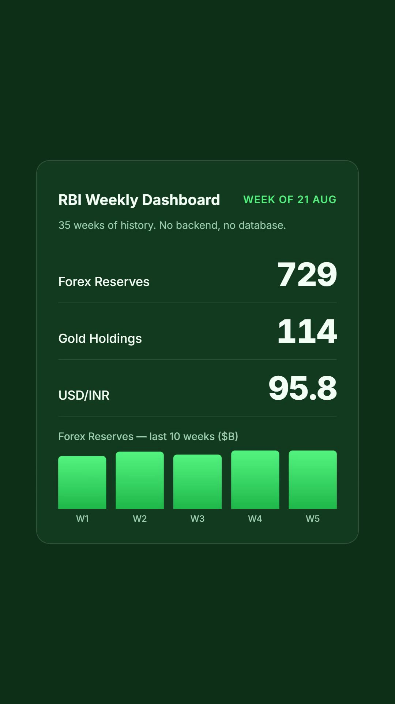

# RBI Weekly Dashboard

The Reserve Bank of India's weekly numbers - foreign exchange reserves, gold, the rupee and the markets - in one readable place.

**Live:** https://rbiweeklydashboard.pages.dev

## Watch it

A 30-second trailer - click the poster to play:

## What you can see

- **The week at a glance** - reserves, gold, the rupee against the dollar and euro, and the main market indexes, each with its move on the previous week
- **History** - trend lines and searchable tables, switchable between 10, 26 and 52 weeks, with the whole fetched history as a CSV download
- **Compare any two weeks** - pick two Fridays and see every headline metric's absolute and percent move, with a shareable link
- **Context** - crude-oil import estimates, FII flows, the repo path with the live 10Y yield, REER, reserves composition, and RBI and Fed decisions marked on the rupee chart
- **The world's biggest borrowers** - a quarterly World Bank ranking of external debt, with India's rank, its maturity split and a debt-to-reserves cover comparison
- **A PM CARES section** - a snapshot of the COVID-era relief fund from its audited accounts
- **Zoomable charts, PNG export, sticky headers, date filters, keys 1–5 and a हि/EN toggle**
- **Installable and offline-friendly** - the last week it fetched still renders when the network is down

## How it stays current

A scheduled job runs once a week, after Friday's RBI report, and re-pulls the World Bank ranking, the forward-book series and FII/DII flows, committing whatever changed so the site deploys with the new numbers. The in-page reload button live-checks RBI for a newer week and bypasses caches.

## Built with

Hand-written **HTML / CSS / JavaScript** on **Cloudflare Pages**, with **Node** automation behind the scrapers and a weekly **GitHub Actions** run refreshing the committed data. No database, no accounts, no sign-up.

---

*Figures correspond to weekly RBI reporting dates. Personal, reference use.*
